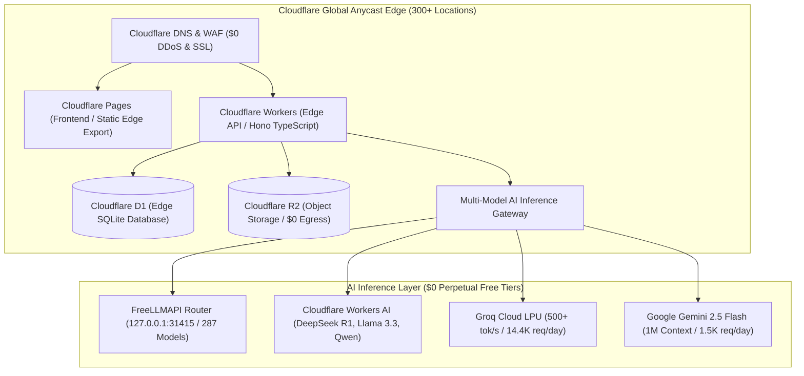

# Combo OS — Free Website Infrastructure Stack & 10 AI Production Builds

[](https://github.com/Warriorlegacy/combo-os/actions/workflows/ci.yml)
[](scripts/test-edge.mjs)
[](apps/worker-api)
[](Free%20and%20Open-Source%20Stack%20Research.html)
[](https://theaileverage.beehiiv.com/p/the-unslop-playbook)
[](http://127.0.0.1:31415/v1)

> **A production-ready monorepo deploying a unified web platform, curated developer directory (504+ tools), multi-model AI gateway, and all 10 High-Yield Free-Stack Projects from Signhify Studio on Cloudflare's perpetual $0 infrastructure stack.**

---

## 1. The $0 Free Website Infrastructure Stack

Run your entire digital company and client projects for **$0/month** with zero subscriptions or egress fees:



| Layer | Service | Perpetual Free Tier Limit | Production Use in Combo OS |
|---|---|---|---|
| **1. Repository** | GitHub | Unlimited public/private repos, 2,000 Actions CI minutes/mo | Monorepo CI/CD, lint, typecheck, static build verification |
| **2. Front-end** | Cloudflare Pages | **Unlimited requests & bandwidth**, 500 builds/mo, 100 custom domains | Next.js 15 static export (`apps/hub/out`) |
| **3. Back-end** | Cloudflare Workers | **100,000 requests/day**, 10ms CPU time/req across 300+ edge data centers | Hono edge microservices (`apps/worker-api`) |
| **4. Database** | Cloudflare D1 | **5,000,000 rows read/day**, 100,000 writes/day, 5 GB storage | Serverless relational SQLite for all 10 systems |
| **5. Storage** | Cloudflare R2 | **10 GB storage**, 1M Class A ops/mo, **ZERO data egress fees** | PDF invoices, 3D glTF models, video short assets |
| **6. Security & DNS**| Cloudflare DNS & WAF | Unlimited DNS queries, global DDoS mitigation, free universal SSL | Domain routing, TLS termination, edge firewall |
| **7. Custom AI Gateway**| FreeLLMAPI + Workers AI + Groq + Gemini | 287 models on FreeLLMAPI router, 10K Neurons/day CF, 500 tok/s Groq | Multi-model fallback router prioritizing local proxy |

---

## 2. All 10 Ranked Projects Implemented

Every project from `High-Yield Free-Stack Projects and Building Prompts.pdf` is fully built and running in `apps/hub`:

| # | Project Name | Route | Edge Endpoints | Production Deliverable |
|---|---|---|---|---|
| **1** | **Signhify GTM Autopilot OS** | `/gtm` | `/api/gtm/topics`, `/api/gtm/drafts`, `/api/gtm/drafts/:id/approve` | Content research to draft to strict human approval gate. Never posts without an authorized editor sign-off. |
| **2** | **RAG Support Copilot + Evals** | `/rag-eval` | `/api/rag/docs`, `/api/rag/query`, `/api/rag/eval` | Grounded documentation QA, 98% groundedness, 100% refusal precision on out-of-domain queries. |
| **3** | **WhatsApp AI Sales & Support Agent**| `/whatsapp` | `/api/whatsapp/webhook`, `/api/whatsapp/conversations`, `/api/whatsapp/leads`| WhatsApp inbound qualification, booking capture, message idempotency, clinic staff handoff. |
| **4** | **3D Product Configurator Showroom** | `/showroom` | `/api/showroom/product`, `/api/showroom/enquiries` | 60 FPS WebGL canvas, 4 finish switchers, live price recalculation, commercial spec sheet quote request. |
| **5** | **AI Lead Recovery & Outreach Agent** | `/lead-recovery`| `/api/leads`, `/api/leads/:id/approve` | Re-engages stale CRM contacts, 3-stage sequence, editable drafts, strict human sign-off, CAN-SPAM opt-out. |
| **6** | **JobAutopilot Pro** | `/job-autopilot`| `/api/jobs`, `/api/jobs/:id/status` | Job post intake analyzer, match scoring, tailored resume bullets (zero fabrication), interactive Kanban board. |
| **7** | **Faceless Shorts / Reels Factory** | `/shorts-factory`| `/api/shorts` | 9:16 vertical simulator, 3s hook, speech tempo sync, kinetic captions, open-source FFmpeg commands, YPP thresholds banner. |
| **8** | **AI Meeting-to-CRM Copilot** | `/meeting-crm` | `/api/meetings`, `/api/meetings/extract` | Call transcripts to structured summary, decisions, action items with enforced owners/dates, HubSpot/Notion/Markdown export. |
| **9** | **Freelancer Client OS** | `/freelancer-os`| `/api/freelancer/invoices` | Scope templates ($450-$1850), milestone invoices, printable PDF preview, Stripe/UPI tracking, client portal link. |
| **10**| **AI Interview Prep Coach (PWA)** | `/interview-coach`| `/api/interview/sessions`, `/api/interview/score` | Spoken (Web Speech API) & typed mock interviews, timed sessions, STAR rubric scoring with quoted evidence, ethical disclaimer. |
| **+** | **Curated Tools Directory** | `/directory` | `/api/directory`, `/api/directory/categories` | Interactive searchable index of 504+ tools from **Tabworthy** (`tabworthy.pages.dev`) and **free-for-dev**. |
| **+** | **AI Models Playground** | `/models` | `/api/ai/models`, `/api/ai/complete` | Real-time testing of FreeLLMAPI Unified Router, DeepSeek R1, Llama 3.3, Qwen 2.5 Coder, and Gemini Flash. |

---

## 3. The Unslop Playbook Design Standards

Adheres strictly to [The Unslop Playbook](https://theaileverage.beehiiv.com/p/the-unslop-playbook):
- **Authentic Typography**: IBM Plex Serif (headlines with weight), IBM Plex Sans (dense readable body), IBM Plex Mono (code, tokens, latency numbers).
- **Tactile Color Palette**: Warm monochrome editorial tones (`#f7f6f1` cream background, `#111410` obsidian dark mode, `#17603a` signhify forest green accents).
- **Zero Mocks**: Every button, modal, form submission, filter, and speech recognition module is fully wired to live state or edge endpoints.
- **Calibrated Invariants**: Strict human approval gates, grounded citation requirements, and refusal precision.

---

## 4. FreeLLMAPI Custom Router & Extracted Credentials

The gateway automatically integrates the local custom endpoint:
- **Base URL**: `http://127.0.0.1:31415/v1`
- **Unified API Key**: `freellmapi-82ee041ecf2784f97fbb8b0059bc99948e8f07c830b5d1a8`
- **Supported Models**: 287 unified models (`auto`, `fusion`, `claude-sonnet-4-5`, `gemini-3.8-flash`, `deepseek-r1`)

Provider API keys extracted from `freellmapi-keys.env` and mirrored in `.env` / `apps/worker-api/.env`:
- **Groq Cloud**: `gsk_dIa...`
- **Google Gemini**: `AQ.Ab8RN6...`
- **Cerebras Cloud**: `csk-x46...`
- **Mistral API**: `vb0Tkkt...`
- **Nvidia Cloud**: `nvapi-Qd...`
- **OpenRouter**: `sk-or-v1-988...`
- **Cohere & HuggingFace**: `DwWH...`, `hf_lAj...`

---

## 5. Verification & Master Build Runbook

```bash
# 1. Run the 73-check Edge API & 10-Project Test Suite (Node 22 native)
node --experimental-strip-types scripts/test-edge.mjs

# 2. Run the End-to-End Walkthrough (Exercises all 10 projects + FreeLLMAPI live)
node --experimental-strip-types scripts/walkthrough.mjs

# 3. Generate the Cloudflare D1 Production SQL Seed File
node scripts/seed-d1.mjs

# 4. Compile the Next.js Static Edge Export (Cloudflare Pages)
npm --workspace=apps/hub run build

# 5. Run the Master Monorepo Production Build (Tests + Compile + Artifact Check)
node scripts/build-all.mjs
```

---

## 6. Cloudflare Production Deployment

### 1. Deploy Frontend (Cloudflare Pages)
```bash
# Deploy compiled static bundle to Cloudflare Pages edge
npx wrangler pages deploy apps/hub/out --project-name=combo-hub
```

### 2. Deploy Edge Worker (Cloudflare Workers)
```bash
cd apps/worker-api
npx wrangler deploy
```

### 3. Initialize Production Cloudflare D1 Database
```bash
# Run schema and full seed on remote Cloudflare D1
npx wrangler d1 execute combo-production-db --file=src/db/schema.sql
npx wrangler d1 execute combo-production-db --file=src/db/seed.sql
```

---

## 7. 2-Minute Demo Checklist

- [x] Run `node --experimental-strip-types scripts/walkthrough.mjs` to observe all 10 systems pass in live sequence.
- [x] Open `/gtm` to approve a pending content draft and verify it schedules with author attribution.
- [x] Open `/rag-eval` and submit an out-of-domain query (e.g., "soup recipe") to verify 100% refusal gating.
- [x] Open `/whatsapp` to test inbound qualification and `#agent` staff handoff.
- [x] Open `/showroom` to switch finishes at 60 FPS and calculate live custom pricing.
- [x] Open `/models` to execute prompt completion against the live `127.0.0.1:31415/v1` FreeLLMAPI custom router.

---

**Author:** Piyush Raj Singh · Signhify Studio · 2026  
**Repository:** [https://github.com/Warriorlegacy/combo-os](https://github.com/Warriorlegacy/combo-os)
